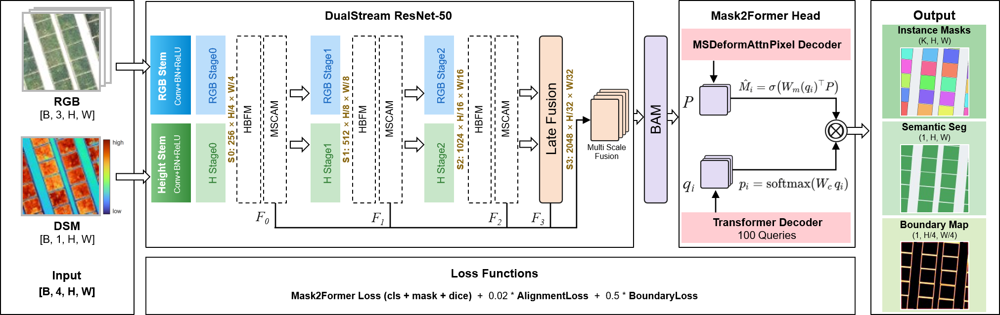
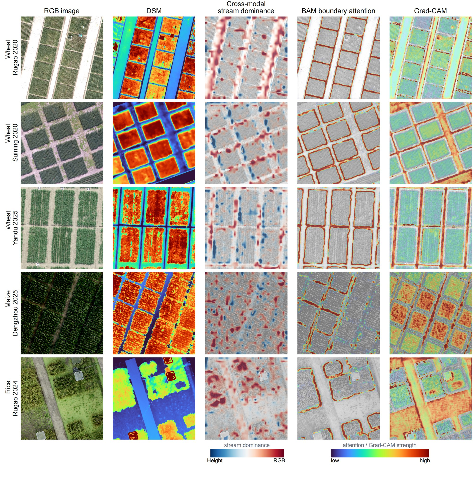
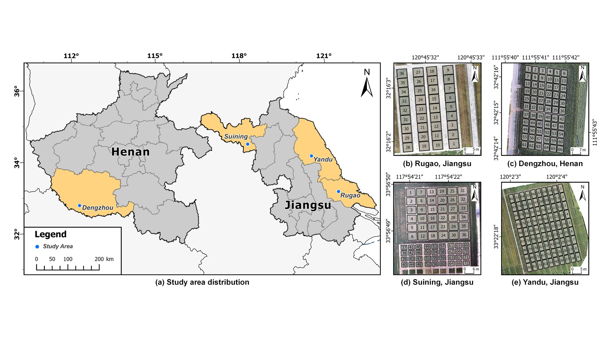
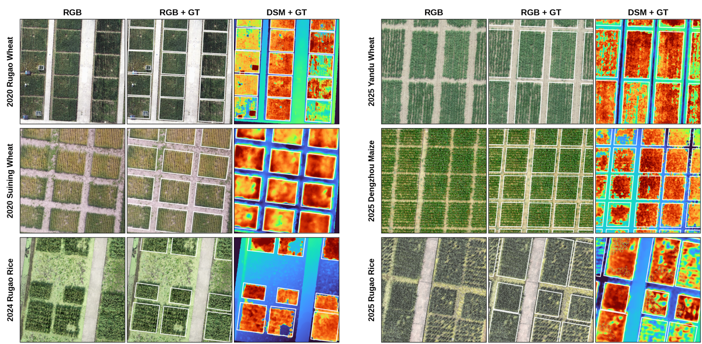
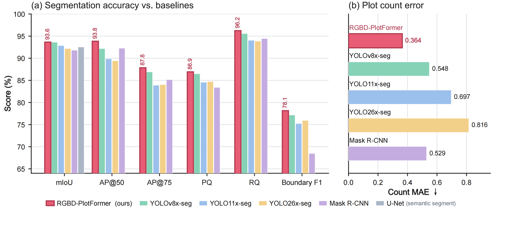
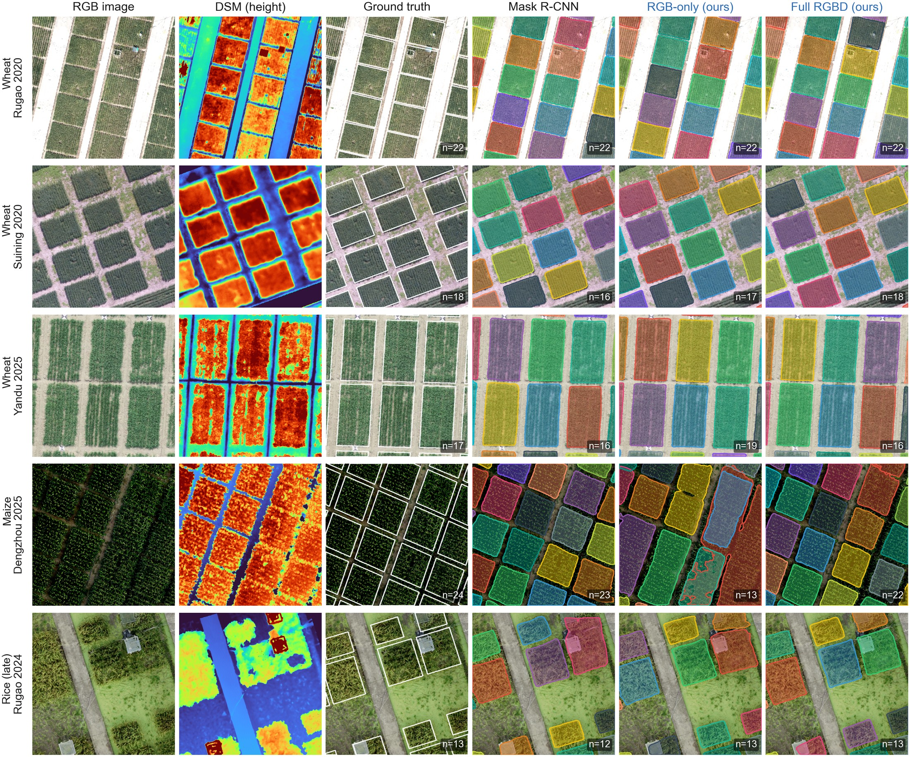
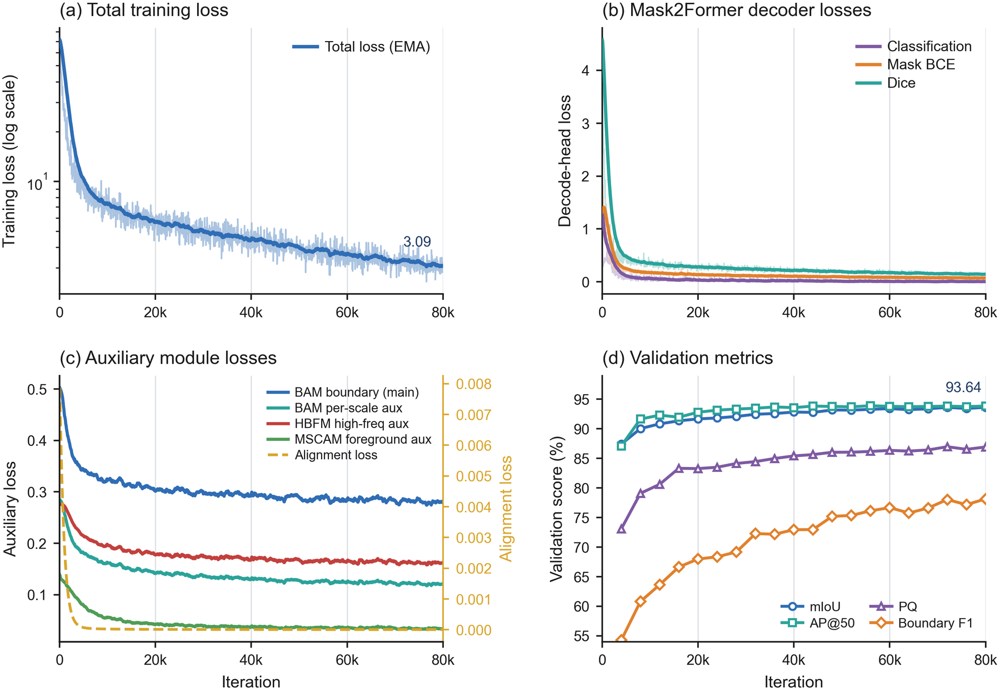
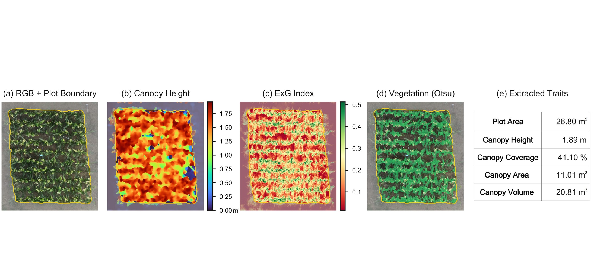
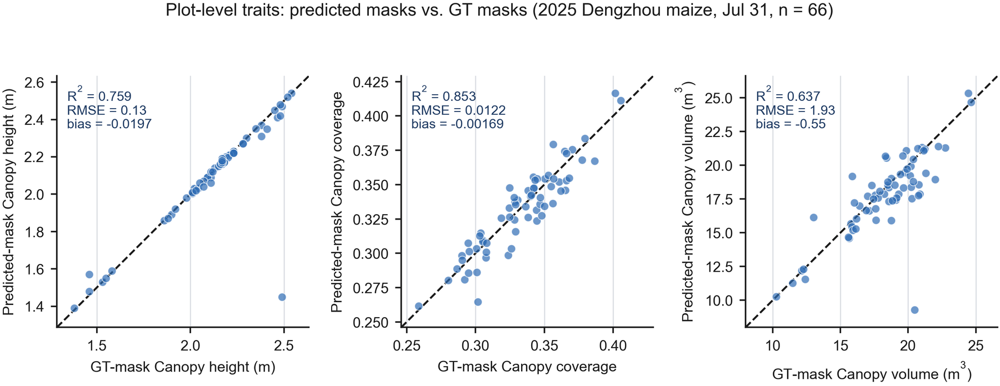

<div align="center">

# Plot2Phenome

### A UAV-Based Deep Learning Framework for Automated Micro-Plot Segmentation and Plot Level Phenotyping

**From RGB–DSM orthomosaics to individually identified breeding plots and canopy traits.**

[](LICENSE)
[](https://huggingface.co/datasets/little-king/Plot2Phenome)
[](#release-status)

**English** · [简体中文](README.zh-CN.md)

Chuanjing Jin · Yan Li · Xiaohu Zhang<br>
Nanjing Agricultural University

Included in the **17th International Conference on Precision Agriculture (ICPA), 2026** proceedings.<br>
[Official proceedings entry](https://www.ispag.org/icpa/proceedings/?action=abstract&id=13942) · ISPA member login may be required.

</div>


*RGBD-PlotFormer, the segmentation model at the heart of Plot2Phenome (manuscript Fig. 3).*

[Overview](#overview) · [Architecture](#architecture) · [Dataset](#dataset) · [Results](#results) · [Phenotyping](#plot-level-phenotyping) · [Code](#working-with-the-code) · [Citation](#citation)

## Overview

Breeding micro-plots become difficult to separate when adjacent canopies close, plot boundaries degrade, or lodging and shadows obscure inter-plot gaps. RGB imagery captures appearance, while a co-registered digital surface model (DSM) supplies complementary canopy structure and height gradients.

**Plot2Phenome** combines these observations in a UAV phenotyping workflow:

1. Generate co-registered RGB orthomosaics and DSMs from UAV imagery.
2. Delineate individual micro-plots with **RGBD-PlotFormer**, a dual-stream instance segmentation network.
3. Convert masks into georeferenced polygons and assign field-oriented plot IDs.
4. Extract plot-level canopy traits within each predicted boundary.

The study covers **6 field experiments · 3 crops · 4 sites · 412 micro-plots**, acquired in China between **2020 and 2025**. The main comparison reports **93.64% mIoU**, **93.84% AP@50**, and **0.364 CountMAE** on the validation set used for checkpoint selection.

> **Release status:** This repository currently provides the core model architecture. The complete workflow described in the manuscript is broader than the code released here; see [Release status](#release-status) before attempting reproduction.

## Architecture

RGBD-PlotFormer uses two parameter-independent **ResNet-50** encoders and a **Mask2Former-style decoder with 100 queries**. The input is RGB plus a single co-registered DSM/height channel; DSM is derived from UAV photogrammetry rather than an active depth sensor.

| Component | Role | Source |
|---|---|---|
| Dual-stream backbone | Encode RGB and height separately; fuse features and re-inject fused information into both streams | [dual_stream_resnet.py](mmseg/models/backbones/dual_stream_resnet.py) |
| HBFM | Hierarchical bimodal fusion using low-/high-frequency height features; the released implementation uses a pooling-based, wavelet-style approximation | [hbfm.py](mmseg/models/utils/hbfm.py) |
| MSCAM | Refine fused features with multi-scale spatial and channel attention | [mscam.py](mmseg/models/utils/mscam.py) |
| BAM | Enhance plot edges using modality-specific feature gradients before decoding | [boundary_attention.py](mmseg/models/utils/boundary_attention.py) |
| Instance head | Match decoder queries to individual plot masks through Hungarian matching | [plot2phenome_instance_head.py](mmseg/models/decode_heads/plot2phenome_instance_head.py) |
| Alignment loss | Align projected, globally pooled RGB and height features with cosine similarity | [alignment_loss.py](mmseg/models/losses/alignment_loss.py) |
| Boundary loss | Supervise predicted boundaries with weighted BCE and Dice loss | [instance_boundary_loss.py](mmseg/models/losses/instance_boundary_loss.py) |

The source also includes [CMGFA](mmseg/models/utils/cmgfa.py), an alternative fusion mode that replaces HBFM + MSCAM. It is a code option, not the architecture used to describe the main manuscript results.

<details>
<summary><strong>Inspect cross-modal behavior</strong></summary>


*Manuscript Fig. 10. Columns show RGB, DSM, stream dominance (red: RGB; blue: height), BAM attention, and plot-class Grad-CAM. These visualizations illustrate the model's use of structural cues near plot boundaries.*

</details>

## Dataset


*Manuscript Fig. 1. Four study sites and representative plot layouts. Outlines identify individual experimental units.*

| Year | Site | Crop | Micro-plots | Field area (ha) | Plot area (m²) | UAV flights |
|---|---|---|---:|---:|---:|---:|
| 2020 | Rugao, Jiangsu | Wheat | 36 | 0.17 | 30 | 3 |
| 2020 | Suining, Jiangsu | Wheat | 72 | 0.24 | 12–30 | 4 |
| 2024 | Rugao, Jiangsu | Rice | 48 | 0.25 | 25–35 | 5 |
| 2025 | Yandu, Jiangsu | Wheat | 90 | 0.29 | 10–25 | 5 |
| 2025 | Dengzhou, Henan | Maize | 66 | 0.30 | 34 | 10 |
| 2025 | Rugao, Jiangsu | Rice | 100 | 0.25 | 25–35 | 5 |
| **Total** | **4 sites** | **3 crops** | **412** | **1.50** | — | **32** |


*Manuscript Fig. 2. RGB, RGB + ground truth, and DSM + ground truth for each experiment. White outlines mark annotated boundaries; DSM colors visualize relative height variation.*

**Preprocessing in the study:** OpenDroneMap orthomosaics and DSMs share a common spatial reference and are divided into overlapping **512 × 512** tiles. RGB, DSM, and masks receive synchronized geometric augmentation; photometric augmentation applies only to RGB. DSM values are percentile-capped and normalized per tile.

### Public preview

The [Hugging Face dataset](https://huggingface.co/datasets/little-king/Plot2Phenome) provides a preview of **RGB patches and YOLO-seg polygon annotations** across the six scenes. The dataset card describes a split by flight date. This RGB preview is distinct from the full paired RGB–DSM research dataset and cannot by itself reproduce the dual-modal experiments.

```text
plot2phenome_preview/
├── data.yaml
├── images/
│   ├── train/
│   └── val/
└── labels/
    ├── train/
    └── val/
```

Each annotation line has the form `class_id x1 y1 x2 y2 ... xn yn`, with preview class `0` denoting a plot and coordinates normalized to `[0, 1]`. The preview is distributed under **CC BY-NC 4.0**; consult its dataset card for release details and terms.

## Results

### Main model comparison

Values below reproduce **Table 2 of the supplied conference manuscript**. Percentage metrics are higher-is-better; CountMAE is lower-is-better. The checkpoint was selected by validation mIoU, so these are validation results rather than an independent held-out site evaluation.

| Model | Input | mIoU ↑ | AP@50 ↑ | AP@75 ↑ | PQ ↑ | SQ ↑ | RQ ↑ | BF1 ↑ | CountMAE ↓ |
|---|---|---:|---:|---:|---:|---:|---:|---:|---:|
| U-Net (s5-d16 + FCN) | RGB | 92.53 | — | — | — | — | — | — | — |
| Mask R-CNN R50-FPN | RGB | 91.81 | 92.27 | 85.16 | 83.40 | 88.31 | 94.45 | 68.47 | 0.529 |
| YOLOv8x-seg | RGB | 93.61 | 92.18 | 86.91 | 86.48 | 90.48 | 95.58 | 77.16 | 0.548 |
| YOLO11x-seg | RGB | 92.86 | 89.87 | 83.90 | 84.57 | 89.93 | 94.05 | 75.24 | 0.697 |
| YOLO26x-seg | RGB | 92.19 | 89.43 | 84.04 | 84.73 | 90.28 | 93.86 | 75.95 | 0.816 |
| **RGBD-PlotFormer** | **RGB + DSM** | **93.64** | **93.84** | **87.84** | **86.92** | **90.52** | **96.24** | **78.15** | **0.364** |


*Manuscript Fig. 5. The proposed model leads the reported metrics. Relative to YOLOv8x-seg, mIoU improves by 0.03 percentage points, BF1 by 0.99 points, and CountMAE decreases from 0.548 to 0.364.*

**Metric guide:** mIoU measures pixel overlap; AP@50/AP@75 measure instance average precision at the indicated IoU thresholds; PQ combines segmentation quality (SQ) and recognition quality (RQ); BF1 evaluates boundaries; CountMAE measures absolute plot-count error.

### Qualitative comparison


*Manuscript Fig. 9. The highlighted canopy-closure example shows adjacent plots merging in RGB-only predictions and being separated by the RGB–DSM model. Insets report detected instance counts.*

<details>
<summary><strong>Training protocol and curves</strong></summary>

| Setting | Manuscript configuration |
|---|---|
| Encoders | Two independent ResNet-50 branches |
| Input tile | 512 × 512 pixels |
| Decoder queries | 100 |
| Optimizer | AdamW |
| Initial learning rate | 1 × 10⁻⁴ |
| Training budget | 80,000 iterations |
| Checkpoint selection | Highest validation mIoU |


*Manuscript Fig. 6. Decoder and auxiliary losses, together with validation metrics.*

</details>

**Ablation reporting:** The supplied manuscript's Table 3, Fig. 7, and main comparison contain inconsistent full-model values. This README uses Table 2 for headline results and does not combine those ablation values into a second benchmark. Exact ablation comparisons require reconciliation of the manuscript and experiment records.

## Plot-level phenotyping

The manuscript describes converting instance masks to map-coordinate polygons, filtering small artifacts, and merging spatially overlapping fragments. Polygon centroids are rotated into the dominant field orientation, clustered into rows, and ordered into columns to assign **`Site-Year-Crop-ID`** identifiers.


*Manuscript Fig. 4. A maize micro-plot in Dengzhou on 31 July 2025: RGB, canopy height, ExG, Otsu vegetation mask, and extracted plot traits.*

| Trait | Extraction described in the manuscript |
|---|---|
| Plot area | Number of mask pixels × GSD² |
| Canopy coverage | Vegetation pixels / plot-mask pixels |
| Excess green (ExG) | Mean of `2g − r − b` inside the plot, using normalized RGB chromatic coordinates |
| Canopy height | 95th percentile of DSM inside the plot minus the 5th percentile in a local outer ring |

### Agreement with manual-mask measurements


*Manuscript Fig. 8. Measurements for 66 maize micro-plots in Dengzhou on 31 July 2025.*

| Trait | R² ↑ | RMSE | Bias |
|---|---:|---:|---:|
| Canopy height | 0.759 | 0.13 m | −0.0197 m |
| Canopy coverage | 0.853 | 0.0122 | −0.00169 |
| Canopy volume | 0.637 | 1.93 m³ | −0.55 m³ |

Coverage is a fraction on `[0, 1]`. These results compare traits extracted from **predicted masks versus manually annotated masks under the same extraction procedure**; they do not establish agreement with in-situ measurements. Independent multi-site evaluation and field validation are identified as future work in the manuscript. The supplied methods do not specify a standalone canopy-volume formula, so none is inferred here.

## Working with the code

### Release status

| Resource | Availability |
|---|---|
| Dual-stream backbone, fusion/attention modules, instance head and losses | Included in this repository |
| RGB preview dataset and polygon labels | [Available on Hugging Face](https://huggingface.co/datasets/little-king/Plot2Phenome) |
| Full paired RGB–DSM dataset | Not included in the current release |
| Runnable training/evaluation pipeline, configs and preprocessing | Not included in the current release |
| Pretrained weights | Not included in the current release |
| Georeferenced plot coding and trait-extraction workflow | Described in the manuscript; not included in this core-code release |

### Inspect the architecture

```bash
git clone https://github.com/Little-King2022/Plot2Phenome.git
cd Plot2Phenome
```

The files are extensions for an **MMSegmentation/MMDetection** environment. This is not a standalone installable Python package: the repository has no complete upstream `mmseg` package, custom-module registration files, training configs, or entry-point scripts. Cloning it alone is therefore insufficient to run training or inference.

The original release lists **PyTorch ≥ 1.13, MMCV ≥ 2.0.0, MMEngine ≥ 0.5.0, MMSegmentation ≥ 1.0.0**, and **MMDetection** for Mask2Former components. These are dependency requirements, not a tested compatibility matrix or a locked reproduction environment.

For integration into an existing compatible OpenMMLab checkout:

- Place and register the custom modules under their corresponding `mmseg.models` subpackages; the instance head imports the upstream `Mask2FormerHead`.
- Provide spatially aligned RGB and DSM inputs as a stacked **`[B, 4, H, W]`** tensor, ordered **R, G, B, height**, and configure the height encoder for one channel.
- Supply **`gt_instance_masks`** and **`gt_instance_labels`** for true instance supervision. The head's semantic fallback does not preserve separate same-class plots. The preview's YOLO class IDs require conversion to the configured head label convention.
- Supply **`gt_boundary_map`** when enabling boundary supervision. Custom loaders, preprocessing, configs, and evaluation must be supplied separately in this release.

### Repository layout

```text
Plot2Phenome/
├── README.md
├── README.zh-CN.md
├── LICENSE
├── docs/images/                           # Figures from the conference manuscript
└── mmseg/models/
    ├── backbones/dual_stream_resnet.py
    ├── decode_heads/plot2phenome_instance_head.py
    ├── losses/
    │   ├── alignment_loss.py
    │   └── instance_boundary_loss.py
    ├── segmentors/
    │   ├── plot2phenome_mask2former.py      # Base semantic segmentor
    │   └── plot2phenome_instance_segmentor.py
    └── utils/
        ├── hbfm.py
        ├── mscam.py
        ├── cmgfa.py                       # Alternative fusion option
        └── boundary_attention.py
```

## Citation

If you use this work, please cite the conference paper in the **Proceedings of the 17th International Conference on Precision Agriculture (2026)**. The [official proceedings entry](https://www.ispag.org/icpa/proceedings/?action=abstract&id=13942) may require an ISPA member login. Use the following BibTeX entry to cite the paper.

```bibtex
@inproceedings{jin2026plot2phenome,
  title     = {Plot2Phenome: A UAV-Based Deep Learning Framework for Automated Micro-Plot Segmentation and Plot Level Phenotyping},
  author    = {Jin, Chuanjing and Li, Yan and Zhang, Xiaohu},
  booktitle = {Proceedings of the 17th International Conference on Precision Agriculture},
  year      = {2026},
  url       = {https://www.ispag.org/icpa/proceedings/?action=abstract&id=13942}
}
```

## License and figure provenance

Code is released under [Apache License 2.0](LICENSE). The public preview dataset has separate [CC BY-NC 4.0 terms](https://huggingface.co/datasets/little-king/Plot2Phenome).

All research figures in this README are taken from the authors' supplied **Plot2Phenome conference manuscript** and resized for web display. See [figure provenance](docs/images/README.md) for the original figure numbers. Figures illustrate the research workflow and experiments; they are not outputs generated by this core-code release.
