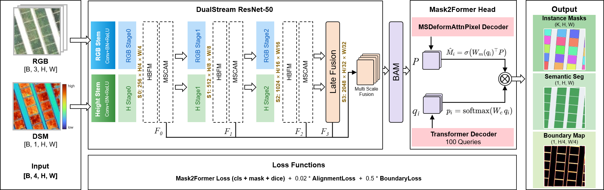
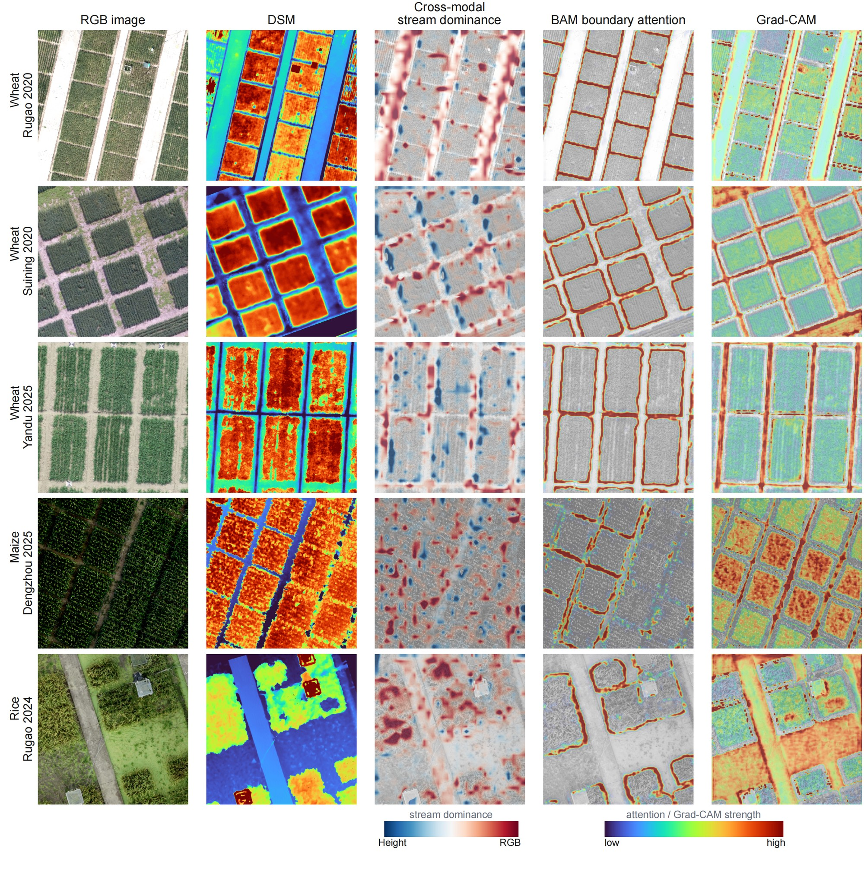
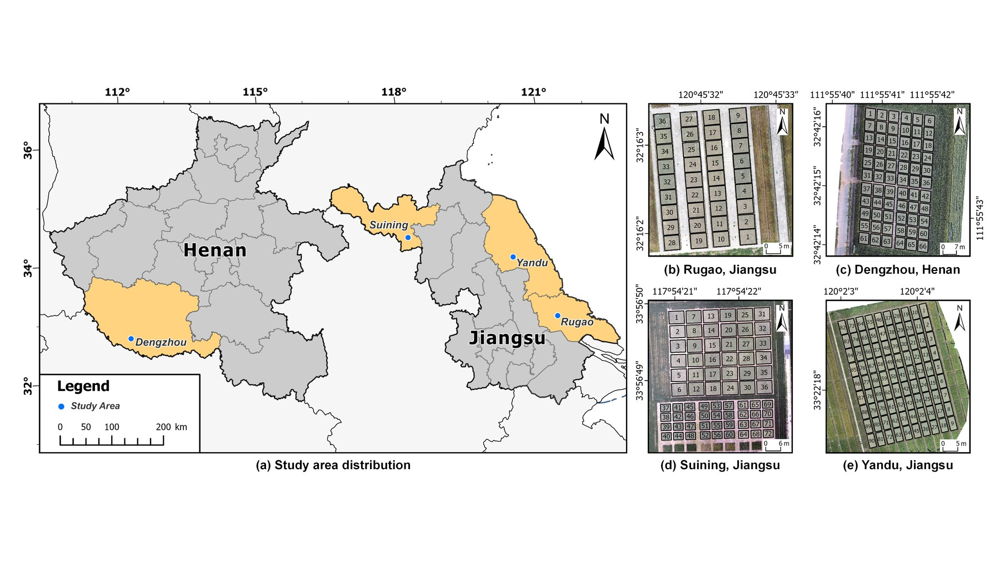
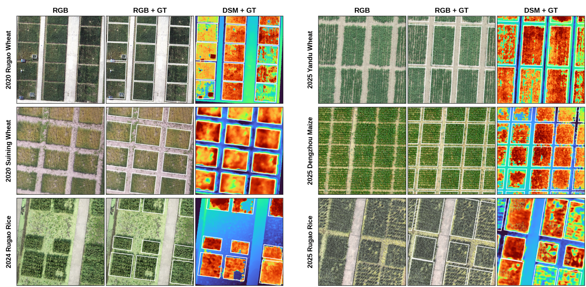
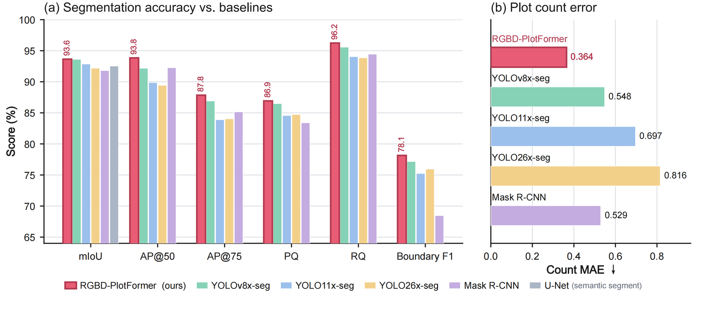
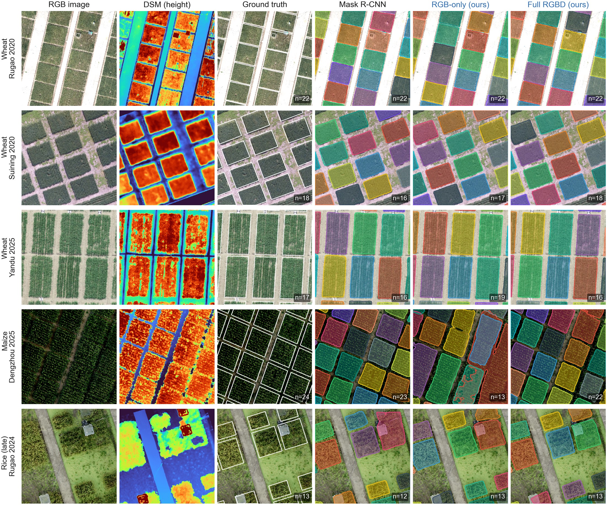
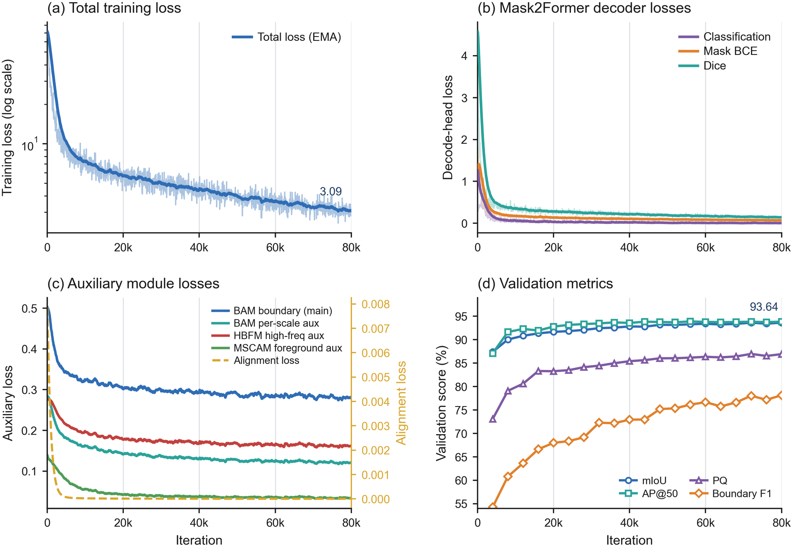
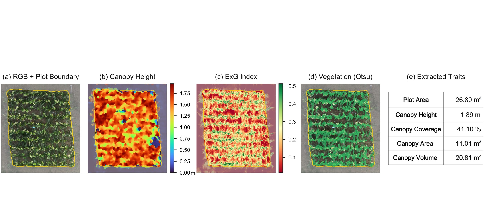
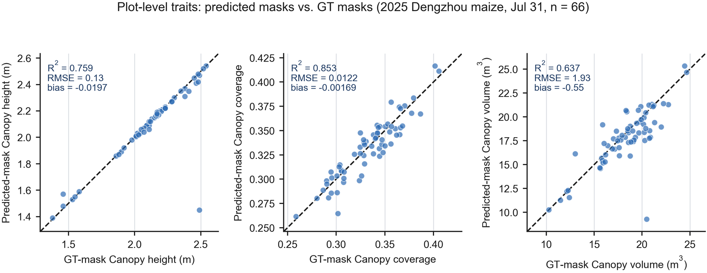

<div align="center">

# Plot2Phenome

### 基于无人机深度学习的育种微小区自动分割与小区级表型分析框架

**从 RGB–DSM 正射影像，到独立育种小区、数字标识与冠层性状。**

[](LICENSE)
[](https://huggingface.co/datasets/little-king/Plot2Phenome)
[](#项目资源)

[English](README.md) · **简体中文**

Chuanjing Jin · Yan Li · Xiaohu Zhang<br>
南京农业大学

已收录于 **第 17 届国际精准农业大会（ICPA，2026）论文集**。<br>
[官方论文集条目](https://www.ispag.org/icpa/proceedings/?action=abstract&id=13942&title=Plot2Phenome%3A+A+UAV-Based+Deep+Learning+Framework+for+Automated+Micro-Plot+Segmentation+and+Plot+Level+Phenotyping&search=authors)

</div>


*论文图 3：RGBD-PlotFormer 是 Plot2Phenome 的核心小区分割模型。*

[项目概览](#项目概览) · [模型架构](#模型架构) · [数据集](#数据集) · [实验结果](#实验结果) · [表型分析](#小区级表型分析) · [代码使用](#代码使用) · [引用](#引用)

## 项目概览

随着冠层封行，相邻育种小区的空隙逐渐消失；倒伏、阴影与边界退化也会降低小区间的视觉差异。RGB 影像提供颜色和纹理信息，配准的数字表面模型（DSM）则补充冠层结构与高度梯度，使模型能够利用两种模态辨识独立小区。

**Plot2Phenome** 将这些信息连接为一套无人机表型分析流程：

1. 从无人机影像生成空间配准的 RGB 正射影像和 DSM。
2. 使用双流实例分割网络 **RGBD-PlotFormer** 识别独立育种微小区。
3. 将掩膜转为地理坐标多边形，按田块方向分配小区数字标识。
4. 在每个小区边界内提取冠层性状。

研究覆盖 **2020—2025 年、6 个田间试验、3 种作物、4 个地点、412 个微小区**。主对比实验在用于选择检查点的验证集上取得 **93.64% mIoU、93.84% AP@50 和 0.364 CountMAE**。

## 模型架构

RGBD-PlotFormer 使用两个参数独立的 **ResNet-50** 编码器，以及具有 **100 个查询的 Mask2Former 风格解码器**。输入由 RGB 三通道和一个配准的 DSM／高度通道组成；这里的 DSM 来自无人机摄影测量重建。

| 组件 | 作用 | 源码 |
|---|---|---|
| 双流骨干网络 | 分别编码 RGB 和高度特征，逐阶段融合，并向两个分支重新注入融合信息 | [dual_stream_resnet.py](mmseg/models/backbones/dual_stream_resnet.py) |
| HBFM | 层次双模态融合，结合高度低频与高频特征 | [hbfm.py](mmseg/models/utils/hbfm.py) |
| MSCAM | 通过多尺度空间与通道注意力细化融合特征 | [mscam.py](mmseg/models/utils/mscam.py) |
| BAM | 在解码前利用模态特征梯度强化小区边缘 | [boundary_attention.py](mmseg/models/utils/boundary_attention.py) |
| 实例分割头 | 通过匈牙利匹配，将解码查询与独立小区掩膜对应 | [plot2phenome_instance_head.py](mmseg/models/decode_heads/plot2phenome_instance_head.py) |
| 跨模态对齐损失 | 对全局池化、投影后的 RGB 和高度特征施加余弦相似度约束 | [alignment_loss.py](mmseg/models/losses/alignment_loss.py) |
| 实例边界损失 | 使用加权 BCE 与 Dice 损失监督预测边界 | [instance_boundary_loss.py](mmseg/models/losses/instance_boundary_loss.py) |

仓库还提供 [CMGFA](mmseg/models/utils/cmgfa.py)，可作为替换 HBFM + MSCAM 的融合选项。

<details>
<summary><strong>查看跨模态特征与边界注意力</strong></summary>


*论文图 10：各列依次为 RGB、DSM、模态贡献（红：RGB；蓝：高度）、BAM 注意力和小区类别 Grad-CAM，展示模型在边界附近对结构信息的利用。*

</details>

## 数据集


*论文图 1：研究地点与代表性小区布局，轮廓线表示独立试验小区。*

| 年份 | 地点 | 作物 | 小区数 | 田块面积（ha） | 单小区面积（m²） | 飞行架次 |
|---|---|---|---:|---:|---:|---:|
| 2020 | 江苏如皋 | 小麦 | 36 | 0.17 | 30 | 3 |
| 2020 | 江苏睢宁 | 小麦 | 72 | 0.24 | 12–30 | 4 |
| 2024 | 江苏如皋 | 水稻 | 48 | 0.25 | 25–35 | 5 |
| 2025 | 江苏盐都 | 小麦 | 90 | 0.29 | 10–25 | 5 |
| 2025 | 河南邓州 | 玉米 | 66 | 0.30 | 34 | 10 |
| 2025 | 江苏如皋 | 水稻 | 100 | 0.25 | 25–35 | 5 |
| **合计** | **4 个地点** | **3 种作物** | **412** | **1.50** | — | **32** |


*论文图 2：六个试验分别展示 RGB、RGB + 真值边界和 DSM + 真值边界。白色轮廓表示小区标注，DSM 伪彩色表示相对高度变化。*

**论文中的预处理：** 使用 OpenDroneMap 生成具有相同空间参考的正射影像与 DSM，并裁切为有重叠的 **512 × 512** 图块。RGB、DSM 和掩膜同步进行几何增强，光度增强只作用于 RGB；DSM 进行百分位截断和逐图块归一化。

### 公开预览数据

[Hugging Face 数据集](https://huggingface.co/datasets/little-king/Plot2Phenome) 提供覆盖六个场景的 **RGB 图块和 YOLO-seg 多边形标注**，数据卡说明其按飞行日期划分训练集与验证集。

```text
plot2phenome_preview/
├── data.yaml
├── images/
│   ├── train/
│   └── val/
└── labels/
    ├── train/
    └── val/
```

每行标注格式为 `class_id x1 y1 x2 y2 ... xn yn`，预览集类别 `0` 表示小区，坐标归一化到 `[0, 1]`。预览集遵循 **CC BY-NC 4.0**，发布详情与使用条件以数据卡为准。

## 实验结果

### 主模型对比

下表展示 RGBD-PlotFormer 与五种基线模型的验证集结果。除 CountMAE 越低越好外，其余指标越高越好，精度类指标以百分数表示。

| 模型 | 输入 | mIoU ↑ | AP@50 ↑ | AP@75 ↑ | PQ ↑ | SQ ↑ | RQ ↑ | BF1 ↑ | CountMAE ↓ |
|---|---|---:|---:|---:|---:|---:|---:|---:|---:|
| U-Net（s5-d16 + FCN） | RGB | 92.53 | — | — | — | — | — | — | — |
| Mask R-CNN R50-FPN | RGB | 91.81 | 92.27 | 85.16 | 83.40 | 88.31 | 94.45 | 68.47 | 0.529 |
| YOLOv8x-seg | RGB | 93.61 | 92.18 | 86.91 | 86.48 | 90.48 | 95.58 | 77.16 | 0.548 |
| YOLO11x-seg | RGB | 92.86 | 89.87 | 83.90 | 84.57 | 89.93 | 94.05 | 75.24 | 0.697 |
| YOLO26x-seg | RGB | 92.19 | 89.43 | 84.04 | 84.73 | 90.28 | 93.86 | 75.95 | 0.816 |
| **RGBD-PlotFormer** | **RGB + DSM** | **93.64** | **93.84** | **87.84** | **86.92** | **90.52** | **96.24** | **78.15** | **0.364** |


*论文图 5：本模型在所报告指标上排名第一。相对 YOLOv8x-seg，mIoU 提高 0.03 个百分点，BF1 提高 0.99 个百分点，CountMAE 从 0.548 降至 0.364。*

**指标说明：** mIoU 衡量像素区域重叠；AP@50／AP@75 是对应 IoU 阈值下的实例平均精度；PQ 综合分割质量 SQ 和识别质量 RQ；BF1 衡量边界质量；CountMAE 衡量小区数量的平均绝对误差。

### 分割效果


*论文图 9：标出的冠层粘连案例中，RGB-only 预测将相邻小区合并，而融合 RGB–DSM 的模型能够将其分离；角标给出检测到的实例数量。*

<details>
<summary><strong>训练设置与训练曲线</strong></summary>

| 设置 | 论文配置 |
|---|---|
| 编码器 | 两个独立的 ResNet-50 分支 |
| 输入图块 | 512 × 512 像素 |
| 解码查询数 | 100 |
| 优化器 | AdamW |
| 初始学习率 | 1 × 10⁻⁴ |
| 训练预算 | 80,000 次迭代 |
| 检查点选择 | 验证集 mIoU 最高 |


*论文图 6：解码器损失、辅助模块损失和验证指标。*

</details>

## 小区级表型分析

论文将实例掩膜转换为地理坐标多边形，过滤零散伪影并合并空间重叠的碎片。将小区质心旋转至田块主方向后，按行聚类、按列排序，生成 **`Site-Year-Crop-ID`** 格式的小区标识。


*论文图 4：2025 年 7 月 31 日邓州玉米小区，展示 RGB、冠层高度、ExG、Otsu 植被掩膜和小区性状。*

| 性状 | 论文中的计算方法 |
|---|---|
| 小区面积 | 掩膜像素数 × 地面采样距离 GSD² |
| 冠层覆盖度 | 植被像素数 / 小区掩膜像素数 |
| 超绿指数 ExG | 小区内 `2g − r − b` 的均值，r、g、b 为归一化 RGB 色度坐标 |
| 冠层高度 | 小区内 DSM 的第 95 百分位，减去局部外缓冲环 DSM 的第 5 百分位 |

### 与人工掩膜提取结果的一致性


*论文图 8：2025 年 7 月 31 日邓州 66 个玉米微小区的对比。*

| 性状 | R² ↑ | RMSE | 偏差 |
|---|---:|---:|---:|
| 冠层高度 | 0.759 | 0.13 m | −0.0197 m |
| 冠层覆盖度 | 0.853 | 0.0122 | −0.00169 |
| 冠层体积 | 0.637 | 1.93 m³ | −0.55 m³ |

覆盖度以 `[0, 1]` 比例表示。采用相同的性状提取流程，对比预测掩膜与人工标注掩膜所得结果的一致性。

## 代码使用

### 项目资源

| 资源 | 链接 |
|---|---|
| 核心模型架构 | [源码](mmseg/models/) |
| RGB 预览数据与多边形标注 | [Hugging Face](https://huggingface.co/datasets/little-king/Plot2Phenome) |

### 查看架构代码

```bash
git clone https://github.com/Little-King2022/Plot2Phenome.git
cd Plot2Phenome
```

核心模型模块基于 **MMSegmentation／MMDetection** 扩展，可集成到版本兼容的 OpenMMLab 工作环境中。

依赖包括 **PyTorch ≥ 1.13、MMCV ≥ 2.0.0、MMEngine ≥ 0.5.0、MMSegmentation ≥ 1.0.0**，以及提供 Mask2Former 组件的 **MMDetection**。

集成到已有、版本兼容的 OpenMMLab 工作环境时，需要：

- 将自定义模块放到相应的 `mmseg.models` 子包并完成注册；实例头依赖上游 `Mask2FormerHead`。
- 提供空间对齐的 **`[B, 4, H, W]`** 输入，通道顺序为 **R、G、B、高度**，并将高度编码器配置为单通道输入。
- 提供 **`gt_instance_masks`** 和 **`gt_instance_labels`**，以进行真实例监督，并将预览数据的 YOLO 类别编号转换为实例头所配置的标签约定。
- 启用边界监督时提供 **`gt_boundary_map`**。

### 仓库结构

```text
Plot2Phenome/
├── README.md
├── README.zh-CN.md
├── LICENSE
├── docs/images/                           # 会议论文配图
└── mmseg/models/
    ├── backbones/dual_stream_resnet.py
    ├── decode_heads/plot2phenome_instance_head.py
    ├── losses/
    │   ├── alignment_loss.py
    │   └── instance_boundary_loss.py
    ├── segmentors/
    │   ├── plot2phenome_mask2former.py      # 基础语义分割器
    │   └── plot2phenome_instance_segmentor.py
    └── utils/
        ├── hbfm.py
        ├── mscam.py
        ├── cmgfa.py                       # 备选融合方式
        └── boundary_attention.py
```

## 引用

使用本研究时，请引用收录于 **第 17 届国际精准农业大会（2026）论文集**的会议论文。[官方论文集条目](https://www.ispag.org/icpa/proceedings/?action=abstract&id=13942&title=Plot2Phenome%3A+A+UAV-Based+Deep+Learning+Framework+for+Automated+Micro-Plot+Segmentation+and+Plot+Level+Phenotyping&search=authors)。可使用以下 BibTeX 条目引用本论文。

```bibtex
@inproceedings{jin2026plot2phenome,
  title     = {Plot2Phenome: A UAV-Based Deep Learning Framework for Automated Micro-Plot Segmentation and Plot Level Phenotyping},
  author    = {Jin, Chuanjing and Li, Yan and Zhang, Xiaohu},
  booktitle = {Proceedings of the 17th International Conference on Precision Agriculture},
  year      = {2026},
  url       = {https://www.ispag.org/icpa/proceedings/?action=abstract&id=13942&title=Plot2Phenome%3A+A+UAV-Based+Deep+Learning+Framework+for+Automated+Micro-Plot+Segmentation+and+Plot+Level+Phenotyping&search=authors}
}
```

## 许可

代码使用 [Apache License 2.0](LICENSE)；公开预览数据另遵循 [CC BY-NC 4.0](https://huggingface.co/datasets/little-king/Plot2Phenome)。
